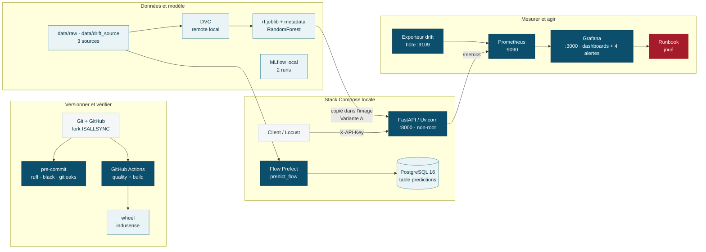
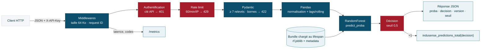
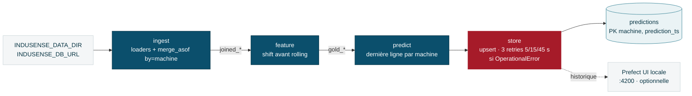
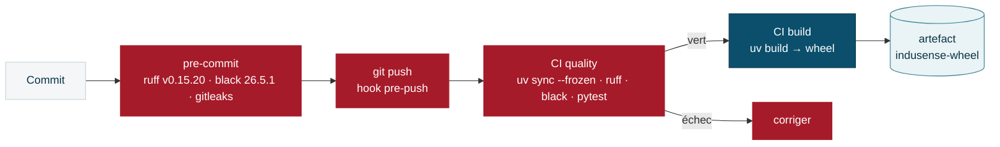

# Dossier d'architecture technique — tel que réalisé

## InduSense 4.0 — Sprint 3 CISIA (modules 23 à 34)

**Statut :** architecture réalisée et prouvée, version 1.0
**Date :** 19 octobre 2026
**Auteur :** Ismaël Sall (branche `ismael-sall`, fork `ISALLSYNC/CISIA_24082026_Parcours`, jalon 10)
**Document de référence :** `DAT_InduSense_Sprint3_v1.0` (4 septembre 2026, architecture **cible** du cours)

> **À retenir** — Ce DAT décrit **ce qui a réellement été construit, exécuté et prouvé** pendant le
> Sprint 3, section par section, en suivant la structure du DAT de référence. Chaque affirmation
> renvoie à une preuve du dépôt (`preuves/`, `docs/`, code). Les écarts avec la référence sont
> **nommés et justifiés**, jamais masqués.

---

## 1. Gestion documentaire

| Élément | Valeur |
|---|---|
| Titre | DAT InduSense 4.0 — Sprint 3 CISIA, tel que réalisé |
| Version | 1.0 |
| Statut | Architecture réalisée, preuves jointes |
| Public | Formateur, jury de soutenance, apprenants |
| Objet | Décrire l'architecture effectivement livrée, ses flux, ses preuves et ses écarts avec la référence |
| Hors périmètre | Production réelle, haute disponibilité, données industrielles réelles, modèle vision |
| Sources | Code du dépôt, `journal_de_bord.md`, `preuves/`, pas-à-pas R2 et PDF détaillé du 13/10/2026 |

### 1.1 Historique

| Version | Date | Évolution |
|---|---|---|
| 1.0 | 19/10/2026 | Création : état réalisé des modules 23 à 34, écarts avec la référence, matrice de recette |

### 1.2 Convention de lecture

| Marquage | Signification |
|---|---|
| ✅ **Réalisé** | Construit, exécuté et prouvé (lien vers la preuve) |
| 🟡 **Partiel** | Construit sous une forme simplifiée ; l'écart est décrit |
| ⬜ **Non réalisé** | Présent dans la référence, absent de la réalisation (hors TP ou non demandé) |
| *Écart* | Différence assumée avec la référence, avec sa justification |

---

## 2. Résumé exécutif

InduSense transforme des relevés de température, de pression et d'incidents en une **probabilité de
panne** par machine. Le Sprint 3 a industrialisé ce parcours sur un poste unique :

- un **paquet Python** reproductible (`src/indusense`, Python 3.13, `uv.lock`) et une **CI** GitHub
  Actions (`quality` + `build`) ;
- le **versionnement** des données et du modèle (DVC, remote local) et le suivi d'expériences (MLflow) ;
- une **API FastAPI** sécurisée (401 / 413 / 422 / 429 / 503) servie par Uvicorn sur `8000` ;
- une **image Docker** multi-stage non-root et une **stack Compose** (API, PostgreSQL 16, Prometheus,
  Grafana) ;
- un **flow Prefect** `ingest → feature → predict → store` **idempotent** (upsert), prouvé sur
  SQLite puis PostgreSQL, et sur le **jeu complet** (15 machines) ;
- la **mesure du drift** (PSI, KS) avec une drift spec, un rapport JSON et une alerte anti-spam ;
- l'**observabilité** : métriques métier, 5 SLO, dashboard Grafana, 4 règles d'alerte, 2 incidents
  joués jusqu'au retour à la normale, runbook.

Le système est **fonctionnel de bout en bout sur ce poste**. Il ne réalise pas la chaîne de livraison
signée, le proxy TLS, Alertmanager ni les workers Prefect de la référence (section 3.2).

### 2.1 Qualités obtenues

| Qualité | Mécanisme réalisé | Preuve | Statut |
|---|---|---|---|
| Reproductibilité | Python 3.13, `pyproject.toml`, `uv.lock`, `uv sync --frozen` (CI et local) | CI verte à chaque push | ✅ |
| Testabilité | Pytest (11 fichiers, 42 tests), TestClient, modèle simulé dans les tests d'API | `42 passed` | ✅ |
| Portabilité | image multi-stage, Compose | `docker compose up -d --build --wait` | ✅ |
| Traçabilité | métadonnées modèle, `X-Request-ID`, runs Prefect, MLflow | `preuves/24_*`, `25_*`, `30_*` | 🟡 pas de `release_id` |
| Résilience | retries ciblés, upsert idempotent, healthchecks | `preuves/30_p2_retries.txt` | ✅ |
| Sécurité | clé API, validation, rate limit, taille, non-root | `preuves/26_*`, `27_*` | 🟡 pas de TLS ni de secret externe |
| Observabilité | `/metrics`, Prometheus, Grafana, SLO, alertes, runbook | `preuves/33_*`, `34_*` | ✅ |
| Livraison continue | CI + wheel ; pas de registry, signature ni promotion | `.github/workflows/ci.yml` | 🟡 |

---

## 3. Périmètre et hypothèses

### 3.1 Inclus et réalisé

- ingestion des trois sources hétérogènes, normalisation des identifiants, jointure par machine ;
- features temporelles sans fuite (`shift(1)` avant `rolling`) ;
- modèle Random Forest entraîné, versionné (DVC, MLflow), chargé au démarrage de l'API ;
- API, contrat Pydantic, sécurité applicative, Model Card, threat model ;
- conteneurisation et stack locale multi-services ;
- orchestration Prefect locale et persistance idempotente des prédictions ;
- drift (deux TP autonomes), SLI/SLO, dashboards, alertes, runbook.

### 3.2 Présent dans la référence, non réalisé

| Élément de la référence | Raison |
|---|---|
| Proxy NGINX, TLS, quota partagé | non demandé par le pas-à-pas ; quota applicatif en mémoire (M26) |
| Image sans modèle + manifeste de release signé (`release_id`, cosign, SBOM) | le TP retient la **Variante A** (modèle dans l'image, M27) |
| Prefect Server durable, work pools, workers train/score, deployments, schedule | le TP utilise le profil `ephemeral` ; la référence de flow arrive au jalon 08 |
| Tables `api_predictions`, `prediction_attempts`, `scoring_watermarks`, migrations Alembic | persistance du TP limitée à `predictions` (M30) |
| Alertmanager, Blackbox exporter, exporteur Prefect `:9110` | alertes portées par Grafana Unified Alerting (M34) |
| Staging / production, promotion, rollback de release | environnement unique (poste local) |
| Sauvegarde / restauration, rétention chiffrée | non demandé |
| Kubernetes | extension hors socle, y compris dans la référence |
| Laboratoire Vision (M33) | fichiers `lab.py` / `test_lab.py` non fournis (PDF seulement) |

### 3.3 Principes d'architecture appliqués

1. **Contrats explicites** : schémas Pydantic, codes HTTP, `/health` vs `/ready`, contrats des tasks
   (`docs/flow_design.md`).
2. **Métier séparé de l'orchestration** : le flow appelle `loaders`, `features`, `models` ; il ne
   réécrit aucune logique métier.
3. **Reproductibilité avant vitesse** : `uv.lock` jamais modifié ; outils ponctuels lancés de façon
   éphémère (`uv run --with locust==2.44.4`, `--with pypdf`).
4. **Défaillance visible** : API sans modèle → `/ready` 503 ; jauge `indusense_model_loaded` à 0.
5. **Idempotence des effets de bord** : clé naturelle `(machine, prediction_ts)` + upsert.
6. **Faible cardinalité** : labels `decision`, `status`, `feature`, `fenetre` ; jamais `machine_id`.
7. **« Pas de données » n'est pas « tout va bien »** : `or vector(0)`, `noDataState` explicite.

---

## 4. Vue globale réalisée



### 4.1 Lecture de gauche à droite

1. Le code, les tests, la configuration et les pointeurs DVC sont versionnés dans Git ; pre-commit
   contrôle avant chaque commit **et** chaque push.
2. La CI reconstruit l'environnement depuis `uv.lock`, exécute ruff, black et pytest, puis construit
   la wheel.
3. Docker Compose construit l'image de l'API (avec le modèle) et démarre API, PostgreSQL, Prometheus
   et Grafana ; healthchecks et smoke tests valident le démarrage.
4. Le flow Prefect lit les sources, calcule les features, prédit une ligne par machine et écrit par
   upsert dans PostgreSQL (ou SQLite en développement).
5. Prometheus collecte l'API et l'exporteur de drift toutes les 15 s ; Grafana affiche les SLO et
   déclenche les alertes ; le runbook décrit la réaction.

### 4.2 Cartographie des composants

| Domaine | Composant réalisé | Critère de fonctionnement | Preuve | Statut |
|---|---|---|---|---|
| Données | pandas, loaders, DVC | 3 sources jointes, 15 machines, résidu 1,76 % | `preuves/33_p0_fusion_jalon10.txt` | ✅ |
| Features | `features/temporal.py` | tests anti-fuite verts | `preuves/23_*`, `tests/test_temporal.py` | ✅ |
| Modèle | scikit-learn, Joblib, DVC, MLflow | bundle chargé, 2 runs MLflow | `preuves/24_*` | ✅ (performances faibles, §5.5) |
| API | FastAPI, Pydantic, Uvicorn | health/ready/predict/metrics testés | `preuves/25_*` | ✅ |
| Sécurité | `api/security.py` | 401 / 413 / 422 / 429 / 400 prouvés | `preuves/26_*` | 🟡 sans proxy ni TLS |
| Orchestration | Prefect 3.7.6, `flows/predict_flow.py` | 2 runs → 0 doublon, retries ciblés | `preuves/30_*` | 🟡 sans server/workers |
| Persistance | SQLAlchemy, psycopg, PostgreSQL 16 | `count1 = count2 = 15` | `preuves/30_preuve_officielle_jeu_complet.txt` | ✅ (une seule table) |
| Conteneurs | Docker, Compose | services healthy | `preuves/27_*`, `28_*` | ✅ |
| Observabilité | Prometheus, Grafana | 2 cibles UP, 8 panneaux alimentés | `preuves/33_*`, `34_*` | ✅ |
| Drift | PSI/KS (miroirs PayGuard et InduSense), exporteur | 12 et 11 tests verts, `0 → 1 → 0` | `preuves/31_*`, `32_*` | ✅ |
| Exploitation | 4 alertes, runbook | incidents A et B Firing → Normal | `preuves/34_incident_*` | ✅ |
| Livraison | CI + wheel | `quality` et `build` verts | onglet Actions du fork | 🟡 |

### 4.3 Définition retenue de « fonctionnel »

La plateforme est déclarée fonctionnelle **sur ce poste** car la recette prouve simultanément :
CI verte et verrou respecté · services Compose sains · modèle chargé (`/ready` 200,
`indusense_model_loaded 1`) · prédiction valide (200) et refus contrôlés (401, 422…) · prédictions
écrites une seule fois (15 → 15) · cibles Prometheus UP · dashboards alimentés · alertes déclenchées
et résolues · runbook joué. Les critères de la référence liés aux releases signées, à la sauvegarde
et au rollback ne sont **pas** couverts (§3.2).

---

## 5. Architecture de l'API

### 5.1 Chaîne de traitement d'une prédiction



### 5.2 Composants mobilisés

| Couche | Outil | Responsabilité | Fichier |
|---|---|---|---|
| Serveur | Uvicorn | ASGI sur `0.0.0.0:8000` | `Dockerfile` |
| Framework | FastAPI | routage, dépendances, OpenAPI `/docs` | `src/indusense/api/main.py` |
| Contrat | Pydantic v2 | types, bornes, minimum 7 relevés | `src/indusense/api/schemas.py` |
| Modèle | scikit-learn, Joblib | chargement au lifespan, `predict_proba` | `api/model_store.py`, `models/tabular.py` |
| Sécurité | middleware + dépendances | clé, taille, rate limit | `src/indusense/api/security.py` |
| Configuration | pydantic-settings | préfixe `INDUSENSE_`, `.env` ignoré par Git | `src/indusense/config.py` |
| Logs | Loguru | `X-Request-ID` | `api/main.py` |
| Métriques | prometheus-fastapi-instrumentator, prometheus-client | `/metrics`, codes non regroupés, jauge et compteur métier | `api/main.py` |

### 5.3 Contrat des endpoints

| Route | Authentification | Rôle | Succès | Erreurs prouvées |
|---|---|---|---|---|
| `GET /health` | Non | Liveness | 200 | — |
| `GET /ready` | Non | Readiness : modèle chargé | 200 | **503** sans modèle |
| `POST /predict-tabular` | `X-API-Key` | Prédiction tabulaire | 200 | **401**, **413**, **422**, **429**, **400** (`Content-Length` illisible), 503 |
| `POST /predict-image` | `X-API-Key` | Route fournie par le jalon 04 (score **simulé**) | 200 | 422 si fichier vide ou non image |
| `GET /metrics` | Non | Métriques Prometheus | 200 | — |
| `GET /docs` | Non | Swagger UI | 200 | — |

*Écart* : la référence protège `/ready`, `/metrics` et `/docs` par un réseau d'administration et
impose une `Idempotency-Key` ; ici, ces routes sont ouvertes sur le poste local et l'API ne persiste
pas ses réponses. *Écart* : `/predict-image` valide réellement le fichier (vide ou non image → 422),
puis renvoie **toujours** `anomaly_score: 0.0` et `decision: "ok"` (« score auto-encodeur à
brancher ») ; la référence interdit toute route d'inférence simulée → à retirer ou à brancher.

### 5.4 Contrat tabulaire

- **Entrée** : `machine_id` et au moins 7 relevés `{timestamp, temperature ∈ [-20 ; 200],
  pressure_bar ∈ ]0 ; 400]}`.
- **Traitement** : normalisation `MACH-xx`, tri, features décalées, dernière observation.
- **Sortie** : `machine_id`, `proba_panne`, `decision`, `model_version`, `threshold`.
- *Écart* : la référence exige des timestamps avec fuseau (UTC) et rejette les timestamps naïfs ; ici
  le type `datetime` les accepte.

### 5.5 Modèle et features

- `RandomForestClassifier` : 200 arbres, `class_weight="balanced"`, `random_state=42`, **12
  features** (2 brutes, 6 lags, 4 moyennes glissantes), 1 896 lignes d'entraînement (échantillon).
- Versionné par DVC (pointeur `rf.joblib.dvc`, remote local `dvc-store`) et par MLflow (2 runs).
- **Limite assumée** (M24) : en split temporel, PR-AUC 0,10, ROC-AUC 0,25 — modèle **pédagogique**,
  inapte à décider ; il sert à faire fonctionner la chaîne.
- *Écart* : seuil **0,5** dans l'API (`settings.decision_threshold`) contre **0,975** dans
  `model_metadata.json` ; la référence impose le seuil porté par le bundle → question au formateur.

### 5.6 Séquence nominale et erreurs (ordre réel du code)

1. `limit_body_size` : corps > 64 Ko → 413 ; `Content-Length` illisible → 400.
2. Middleware request ID.
3. Authentification (`require_api_key`) → 401.
4. Rate limit (`rate_limit_dependency`, 60 requêtes / 60 s / IP, en mémoire) → 429.
5. Validation Pydantic → 422.
6. Modèle absent → 503.
7. Features, `predict_proba`, décision, compteur `indusense_predictions_total`, réponse.

### 5.7 Sécurité opérationnelle réalisée

- clé d'API lue dans `.env` (ignoré par Git), jamais journalisée ;
- conteneur non-root (`appuser`, UID 10001) ;
- labels Prometheus sans identifiant machine ;
- `docs/threat_model.md` (STRIDE) et `docs/security_controls.md` : **4 contrôles implémentés**
  (auth, validation, rate limit, taille) et **audit logging planifié v0**.
- *Écart* : pas de TLS, pas de secret externe, rate limit non partagé entre processus.

---

## 6. Orchestration Prefect

### 6.1 Vue de fonctionnement réalisée



### 6.2 Flow réalisé : `src/indusense/flows/predict_flow.py`

| Task | Entrée | Sortie / effet | Résilience |
|---|---|---|---|
| `ingest` | 3 sources | population `joined` journalisée (`joined_rows`, `joined_panne_rate`) | aucune (erreur déterministe) |
| `feature` | `joined` | population `gold` (`dropna`) | aucune (calcul pur) |
| `predict` | `gold`, modèle, seuil | une prédiction par machine | aucune |
| `store` | prédictions, `INDUSENSE_DB_URL` | upsert, `count(*)` avant/après | **3 retries** (5 / 15 / 45 s), **uniquement** sur `OperationalError` (`retry_condition_fn`) |

Toutes les tasks ont `cache_policy=NO_CACHE`. L'URL de la base est lue dans l'environnement et n'est
ni passée en paramètre Prefect ni journalisée.

### 6.3 Modes d'exécution

| Mode | Usage | Preuve |
|---|---|---|
| `PREFECT_PROFILE=ephemeral` sur l'hôte, SQLite neuve | développement | `preuves/30_tp_sqlite_idempotence.txt` |
| dans le service `api` de Compose, PostgreSQL neuf | preuve officielle | `preuves/30_preuve_officielle_jeu_complet.txt` |
| serveur Prefect local (`127.0.0.1:4200`) | observer l'historique des runs | journal M30 |

*Écart majeur* : pas de Prefect Server durable, de deployments, de work pools, de workers ni de
schedule ; entraînement et scoring ne sont pas séparés en deux deployments. Le flow de référence
(`flows/pipeline.py`) arrive avec le jalon 08.

### 6.4 Reprise et idempotence

- Clé naturelle `PRIMARY KEY (machine, prediction_ts)` ; `INSERT … ON CONFLICT … DO UPDATE` sur
  `proba_panne` et `decision` ; `created_at` (UTC) conservé à la relance.
- Preuve : **0 → 15 puis 15 → 15**, 0 doublon, en PostgreSQL sur le jeu complet.
- Retries : URL absente → échec immédiat sans retry ; base injoignable → `Retry 1/3` (5 s),
  `2/3` (15 s), `3/3` (45 s) (`preuves/30_p2_retries.txt`).
- *Écart* : la référence distingue `INSERTED / REPLAY_SAME / CONFLICT_PAYLOAD / FAILED`, journalise
  les tentatives et porte la clé par environnement et `release_id`.

### 6.5 Configuration

Paramètres par variables d'environnement ; `docs/flow_design.md` fige le design (M29) et décrit
l'implémentation (M30). *Écart* : pas de `prefect.yaml`.

---

## 7. Données, modèle et persistance

### 7.1 Sources et fusion

| Source | Format | Identifiants bruts | Échantillon `data/raw` | Jeu complet `data/drift_source` |
|---|---|---|---|---|
| Température | CSV `;` | `MACH-01` | 1 920 relevés | **66 800** relevés |
| Pression | TSV | `MACH_01` | 1 920 | 65 529 |
| Incidents | CSV `date` + `time` | `M-1`, `M-01` | 8 | 283 |

- `merge_asof(by="machine", tolerance=90 min, direction="nearest")` ; cible `panne` = 24 h avant un
  incident.
- Jeu complet : `joined_rows=65625`, panne **4,7802 %** · `gold_rows=64625`, **4,81 %** · **1 175**
  températures non jointes (**1,76 %**) · 15 machines.
- *Écart* : la référence impose `direction="backward"` (jamais de pression postérieure) et des
  timestamps UTC ; la réalisation utilise `nearest` (code fourni).
- *Anomalie relevée* : `load_pressure` convertit en UTC les 384 lignes `+01:00` et laisse les autres
  telles quelles → 380 doublons `(machine, timestamp)` dans l'échantillon (`preuves/30_p0_audit_raw.txt`)
  → question au formateur.

### 7.2 Prévention de la fuite temporelle

- `shift(1)` avant `rolling`, tri par machine et timestamp (`tests/test_temporal.py`).
- Pièges joués : fuite inter-machines sans `by="machine"` (75 % des lignes contaminées, M29) ; cible
  sur la date seule (192 / 1 920 étiquettes fausses à taux identique, M30).

### 7.3 Artefacts

| Artefact | Rôle | Gouvernance réalisée |
|---|---|---|
| `artifacts/models/rf.joblib` | modèle | DVC (pointeur dans Git, contenu dans `dvc-store`) ; copié dans l'image |
| `model_metadata.json` | version, features, seed, seuil 0,975 | versionné dans Git |
| runs MLflow | paramètres, métriques, 2 versions `indusense-rf` | base SQLite locale |
| table `predictions` | une prédiction par machine | PostgreSQL / SQLite |
| rapports drift | `reports/drift/*.csv`, `drift_report_f2.json` | versionnés |

### 7.4 Contrat de persistance réalisé

```text
predictions(machine VARCHAR(16), prediction_ts TIMESTAMP, proba_panne DOUBLE PRECISION,
            decision VARCHAR(8), created_at TIMESTAMP WITH TIME ZONE,
            PRIMARY KEY (machine, prediction_ts))
```

Même SQL pour SQLite et PostgreSQL ; `prediction_ts` = heure métier sans fuseau, `created_at` =
instant d'audit UTC. *Écart* : pas de migrations, de vues multi-releases ni de rétention (§3.2).

---

## 8. Conteneurisation et exécution locale

### 8.1 Image API

- Multi-stage `python:3.13-slim` (`build` puis `runtime`), `uv sync --frozen --no-dev`.
- Utilisateur `appuser` (UID 10001), `HEALTHCHECK` sur `/health`, Uvicorn sur `0.0.0.0:8000`.
- **Variante A** : `COPY artifacts/models` → le modèle est **dans** l'image (`/ready` 200 d'emblée).
- Taille mesurée : 1,81 Go (`indusense:0.1.0`, M27) ; réduction des dépendances **non retenue**
  (objectif du module = conteneuriser, `uv.lock` intouchable).
- *Écart* : la référence sépare image et modèle (bundle externe signé).

### 8.2 Services Compose

| Service | Image | Port hôte | Dépendance | Persistance |
|---|---|---|---|---|
| `api` | build local, `indusense-api:v1.0` | 8000 | `db` healthy | — |
| `db` | `postgres:16` (healthcheck `pg_isready`) | non publié | — | volume `pgdata` |
| `prometheus` | `prom/prometheus:v2.53.0`, `extra_hosts host.docker.internal` | 9090 | — | — |
| `grafana` | `grafana/grafana:11.1.0`, provisionnement monté | 3000 | `prometheus` | — |
| exporteur drift | `scripts/export_drift_metrics.py` **sur l'hôte** | 9109 | — | lit `reports/drift/` |

### 8.3 Réseau

L'API joint la base par **`db:5432`** (nom de service) ; Prometheus collecte `api:8000` et
`host.docker.internal:9109` ; Grafana interroge `http://prometheus:9090`. *Écart* : ports
d'administration publiés sur le poste, sans filtrage.

### 8.4 Démarrage

`docker compose config -q` puis `docker compose up -d --build --wait` (≈ 8 min avec reconstruction
de l'image sur ce poste) ; projets Compose **neufs** (`COMPOSE_PROJECT_NAME`) pour isoler les bases
de preuve.

### 8.5 Kubernetes

⬜ Non réalisé (extension hors socle, comme dans la référence).

---

## 9. CI/CD

### 9.1 Chaîne réalisée



### 9.2 Gates réalisés

1. `uv sync --frozen --extra dev` ; 2. `ruff check .` ; 3. `black --check .` ; 4. `pytest -q` ;
5. secrets : gitleaks en pre-commit (secret factice bloqué au M24) ; 6. build de la wheel.

- Versions des hooks **alignées sur `uv.lock`** (incident du 12/10 : black 24.8.0 du hook contre
  26.5.1 de la CI) ; exclusion des TP autonomes `FORMATION/EXERCICES`.
- *Écart* : `--frozen` au lieu de `--locked` ; pas d'audit de dépendances, de scan d'image, de SBOM,
  de signature, de registry ni de promotion.

---

## 10. Observabilité, drift et exploitation

### 10.1 Chaîne de supervision réalisée

- **API** : `Instrumentator(should_group_status_codes=False)` (401 isolés) ; jauge
  `indusense_model_loaded` (0/1, mise à jour au lifespan) ; compteur `indusense_predictions_total`
  (label `decision`).
- **Exporteur drift** (`:9109`) : `indusense_drift_psi`, rappel, précision, taux d'alerte, ROC-AUC.
- **Prometheus** : 2 cibles **UP**, collecte toutes les 15 s.
- **Grafana** : dashboard fourni « dérive & métriques » + **mon dashboard « InduSense — SLO (M34) »**
  (8 panneaux, rangées Service / Modèle / Données), provisionnés depuis Git.

### 10.2 Seuils de drift (drift spec)

| PSI | Interprétation | Décision |
|---|---|---|
| < 0,10 | RAS | — |
| 0,10 – 0,25 | à surveiller | pas d'alerte |
| > 0,25 | dérive forte | **alerte** ; KS en confirmation seulement |

Références par **régime** (`normale` / `haute`, choisies selon le planning métier) ; calcul quotidien
sur 7 jours glissants (≥ 2 000 relevés) ; KPI métier **rappel** (< 0,60 → alerte) ; hystérésis
(silence jusqu'à PSI < 0,10). Livrable : `FORMATION/EXERCICES/tp_drift_indusense/reports/drift_spec_indusense.md`.

Résultats clés : fenêtre 2 (+8 °C) PSI **6,845**, rappel tenu 0,784 · fenêtre 3 (concept drift) PSI
0,002, rappel **0,053** · janvier **6,213** vs `normale`, **0,001** vs `haute`.

### 10.3 Signaux et SLO (`docs/slo.md`)

| # | SLI | Objectif (30 j) | Mesuré le 19/10 |
|---|---|---|---|
| 1 | `avg_over_time(up{job="indusense-api"}[30d])` | ≥ 99 % | 99,65 % ✅ |
| 2 | p95 `/predict-tabular` | < 1 s | 2,1 s sous charge ❌ (objectif à atteindre) |
| 3 | part de 5xx | < 1 % | 0 ✅ |
| 4 | PSI température (fenêtre courante, référence du régime) | < 0,25, 29 j / 30 | 0,001 ✅ |
| 5 | `up{job="indusense-drift"}` | ≥ 99 % | 97,9 % ❌ (démarrage tardif) |

*Limite* : buckets de latence ≤ 0,1 / 0,5 / 1 s → la p95 PromQL plafonne à 1 s (2,1 s réelle
cachée) ; action : ajouter des buckets au-delà d'1 s.

### 10.4 Règles d'alerte (`monitoring/grafana/provisioning/alerting/rules.yml`)

| Règle | Condition | `for:` | Absence de données |
|---|---|---|---|
| PROD — latence | p95 > 300 ms | 5 m | OK |
| PROD — erreurs | 5xx > 1 % | 5 m | OK (`or vector(0)`) |
| EXERCICE — API morte | `up < 1` | 1 m | **Alerting** |
| EXERCICE — pic de 401 | > 0,1 / s | 1 m | OK |

Export séparé : `preuves/34_export_regles_alerte.yaml`. Source de données à `uid: prometheus` figé.
*Écart* : Grafana Unified Alerting au lieu de règles Prometheus + Alertmanager ; aucune destination
de notification configurée (observation dans l'interface).

### 10.5 Runbook joué (`docs/runbook.md`)

| Incident | Pending | Firing | Action | Normal |
|---|---|---|---|---|
| A — API morte (`docker compose stop api`) | T+25 s | T+85 s | `docker compose up -d --wait api` | T+150 s |
| B — pic de 401 (POST sans clé) | T+42 s | T+102 s | arrêt de la source | T+193 s |

---

## 11. Sécurité et frontières de confiance

### 11.1 Actifs

Données capteurs et incidents (opérateurs pseudonymisés) · modèle et seuil · clé d'API et mot de
passe PostgreSQL (`.env`) · prédictions · code et CI.

### 11.2 Frontières réalisées

1. client → API (`X-API-Key`, sans proxy) ; 2. API / flow → PostgreSQL (`db:5432`, réseau Compose) ;
3. Prometheus → `/metrics` et exporteur ; 4. Grafana → Prometheus ; 5. GitHub Actions → dépôt.

### 11.3 Menaces et contrôles

| Menace | Contrôle réalisé | Preuve | Statut |
|---|---|---|---|
| appel non autorisé | `X-API-Key` → 401 | `tests/test_api.py`, incident B | ✅ |
| déni de service | 64 Ko → 413, 60 req/min/IP → 429 | `tests/test_security.py` | 🟡 non partagé entre processus |
| données malformées | Pydantic → 422 | tests M25 | ✅ |
| fuite de secret Git | gitleaks pre-commit, `.env` ignoré | sentinelle AWS bloquée (M24) | ✅ |
| fuite par les logs | test de non-divulgation | `tests/test_logs_no_leak.py` | ✅ |
| exécution privilégiée | non-root UID 10001 | `whoami` = `appuser` (M27) | ✅ |
| fuite par les métriques | pas de `machine_id` en label | §10.1 | ✅ |
| interfaces techniques exposées | — | — | ⬜ ports publiés, Grafana `admin/admin` (développement) |
| altération du modèle | pointeur DVC (md5) | md5 identique DVC / image (M27) | 🟡 pas de signature |

---

## 12. Environnements

| Environnement | Réalisé | Données | Orchestration | Exposition |
|---|---|---|---|---|
| Développement (hôte) | ✅ | `data/raw` | flow `ephemeral`, SQLite `$env:TEMP` | localhost |
| Atelier intégré (Compose) | ✅ | `data/drift_source` (jeu complet) | flow dans le service `api` | ports 8000 / 9090 / 3000 |
| Staging / production | ⬜ | — | — | — |

Configuration par variables `INDUSENSE_*` et `.env` (seul `.env.example` est versionné). Chaque
prédiction porte `model_version` et `threshold` ; *écart* : pas de `release_id`, commit ni run
Prefect en base.

---

## 13. Tests et critères de recette

### 13.1 Couverture réalisée

| Niveau | Réalisé | Critère |
|---|---|---|
| Unitaire | loaders, normalisation, features, nettoyage, drift | 42 tests verts |
| API | contrat, 401, 413, 400, 422, 429, 503, request ID, logs | verts |
| Stack | 3 smoke tests Compose (`/health`, 401, 200) | verts stack démarrée, sautés sinon |
| Idempotence | 2 runs SQLite et PostgreSQL | 0 doublon |
| Charge | Locust 20 utilisateurs, 30 s | 0 échec, 0 429 ; p95 2,1 s |
| Livraison, reprise | — | ⬜ |

### 13.2 Recette de bout en bout réalisée

1. `uv sync --frozen --extra dev --extra mlops` · `pytest` · `ruff` · `black` · `pre-commit` ;
2. `docker compose up -d --build --wait` → services sains ;
3. prédiction 200 avec clé, 401 sans clé ;
4. flow ×2 sur PostgreSQL neuf → 15 → 15 ;
5. 2 cibles Prometheus UP ; `indusense_model_loaded 1` ;
6. dashboards alimentés ; incidents A et B Firing → Normal ; runbook joué.

### 13.3 Matrice de recette exécutable

| Contrôle | Exécution | Résultat obtenu | Preuve |
|---|---|---|---|
| Qualité | `uv run --frozen pytest -q` · `ruff check .` · `black --check .` | 42 passed, propres | CI verte |
| Secret bloqué | `pre-commit run gitleaks --files fuite_demo.txt` | `leaks found: 1` | `preuves/24_*` |
| Versionnement | `dvc status` · runs MLflow | pointeurs synchronisés, 2 `run_id` | `preuves/24_*` |
| Codes HTTP | `pytest tests/test_api.py tests/test_security.py` | 401, 413, 422, 429 | `preuves/26_*` |
| Readiness | `pytest tests/test_readiness_probe.py` | 503 sans modèle | `preuves/25_*` |
| Non-root | `docker exec indusense whoami` | `appuser` | `preuves/27_*` |
| Stack | `docker compose up -d --wait` · smoke tests | healthy, 3 verts | `preuves/28_*` |
| Fuite inter-machines | démo `merge_asof` sans / avec `by` | 75 % contaminées / 0 % | `preuves/29_p2_*` |
| Idempotence officielle | 2 runs du flow dans Compose | 0 → 15 → 15, 0 doublon | `preuves/30_preuve_officielle_jeu_complet.txt` |
| Retries | URL absente / base injoignable | 0 retry / 3 retries 5-15-45 s | `preuves/30_p2_retries.txt` |
| Drift | `drift_lab.py` 4 fenêtres + contre-épreuve | 6,845 · 0,053 · 6,213 / 0,001 | `preuves/31_*` |
| Anti-spam | `alerting_demo.py` | `0 → 1 → 0`, 1 ligne `drift_events` | `preuves/32_01_*` |
| Miroir drift | `pytest tests` (miroir) | 11 passed | `preuves/32_02_*` |
| Métriques custom | prédiction puis `/metrics` | jauge 1, compteur `ok` 1, 401 isolé | `preuves/33_p2_*` |
| Charge et PromQL | Locust + requêtes | 0 échec ; p95 PromQL 1 (sous-estimée) ; readiness 1 | `preuves/33_p3_*` |
| Alertes | incidents A et B | Firing → Normal | `preuves/34_incident_*` |

---

## 14. Risques et mesures de maîtrise

| Priorité | Risque | Mesure réalisée | Résiduel |
|---|---|---|---|
| P0 | modèle absent | `/ready` 503 + jauge 0 | pas de vérification d'intégrité signée |
| P0 | doublons au rejeu | clé naturelle + upsert | pas de journal des tentatives |
| P0 | fuite temporelle | `shift(1)`, tests, pièges joués | — |
| P1 | modèle peu performant (ROC-AUC 0,25) | limite documentée (Model Card) | **ne pas utiliser pour décider** |
| P1 | dérive non détectée | drift spec, PSI + rappel, alertes | concept drift visible seulement avec labels |
| P1 | latence sous charge (p95 2,1 s) | SLO et alerte 300 ms | à optimiser ; buckets à étendre |
| P1 | secret divulgué | `.env` ignoré, gitleaks | Grafana `admin/admin` (développement) |
| P2 | supervision aveugle | SLO 5, `noDataState: Alerting` sur `up` | exporteur hors Compose, lancé à la main |
| P2 | perte de données | volume `pgdata` | pas de sauvegarde |

---

## 15. Décisions d'architecture (réalisées)

| ID | Décision | Justification | Conséquence |
|---|---|---|---|
| ADR-R01 | FastAPI + Pydantic, modèle chargé au lifespan | contrat généré, pas d'I/O par requête | readiness dépend du modèle |
| ADR-R02 | Variante A (modèle dans l'image) | consigne M27, `/ready` 200 d'emblée | rebuild pour changer de modèle (≠ référence) |
| ADR-R03 | flow orchestrant la lib existante | logique métier unique et testée | flow léger, remplaçable |
| ADR-R04 | retries **seulement** sur `store`, **seulement** sur `OperationalError` | ne réessayer que le transitoire | échec immédiat sur erreur déterministe |
| ADR-R05 | clé naturelle + upsert, même SQL SQLite / PostgreSQL | idempotence portable | dev rapide sur SQLite, preuve sur PostgreSQL |
| ADR-R06 | flow exécuté **dans** le service `api` | `db:5432` n'existe que sur le réseau Compose | rebuild de l'image après modification du flow |
| ADR-R07 | données de dev = `data/raw`, pas le gold | exercer les 4 tasks | chiffres différents de la référence jusqu'au jeu complet |
| ADR-R08 | une référence de drift par régime | éviter les fausses alertes de campagne | dépend du planning métier |
| ADR-R09 | PSI décide, KS confirme ; KPI rappel | KS sur-sensible aux grands effectifs ; PSI aveugle au concept drift | deux rideaux de surveillance |
| ADR-R10 | codes HTTP non regroupés, labels à faible cardinalité | isoler les 401 sans exploser les séries | alerte « pic de 401 » possible |
| ADR-R11 | dashboards et alertes **provisionnés** depuis Git, `uid` figé | reproductible, versionné, export natif | rien n'est configuré « à la main » |
| ADR-R12 | alerte de latence (300 ms) plus stricte que le SLO (1 s) | prévenir avant la violation | sonne sous charge sur ce poste |
| ADR-R13 | hooks pre-commit alignés sur `uv.lock` | même verdict que la CI | mise à jour conjointe obligatoire |

---

## 16. Traçabilité modules 23 à 34

| Module | Réalisé | Preuve principale | Sections | Compétence |
|---|---|---|---|---|
| M23 | paquet `src/`, CLI, anti-fuite, normalisation | `preuves/23_*` | 4, 7 | C6 |
| M24 | pre-commit, CI quality + build, DVC, MLflow | `preuves/24_*`, `versioning_strategy.md` | 7, 9 | C6 / C8 |
| M25 | API, TestClient, request ID, Model Card | `preuves/25_*`, `docs/model_card.md` | 5 | C7 / C4-C5 |
| M26 | threat model, 4 contrôles prouvés | `preuves/26_*`, `security_controls.md` | 5, 11 | C2 |
| M27 | image multi-stage non-root, Variante A | `preuves/27_*` | 8 | C6 |
| M28 | Compose, healthcheck, smoke tests | `preuves/28_*`, `tests/test_smoke_compose.py` | 8, 13 | C6 / C7 |
| M29 | flow « hello », design, piège inter-machines | `preuves/29_*`, `docs/flow_design.md` | 6, 7 | C6 / C7 |
| M30 | flow idempotent, retries, preuve officielle | `preuves/30_*` | 6, 7 | C6 / C7 |
| M31 | PayGuard (12 tests), miroir (4 fenêtres, contre-épreuve) | `preuves/31_*` | 10 | C3 / C8 |
| M32 | rapport JSON, cooldown, drift spec | `preuves/32_*` | 10 | C3 / C8 |
| M33 | métriques custom, charge, PromQL, 5 SLO | `preuves/33_*`, `docs/slo.md` | 5, 10 | C6 / C8 |
| M34 | dashboard SLO, 4 alertes, incidents, runbook | `preuves/34_*`, `docs/runbook.md` | 10 | C6 / C8 |

---

## 17. Glossaire

Voir [`docs/glossaire_detaille_sprint3.md`](glossaire_detaille_sprint3.md) : 184 termes avec
définition, rôle et exemple tiré de ce TP.

---

## 18. Sources et provenance

| Sujet | Source |
|---|---|
| API | `src/indusense/api/main.py`, `schemas.py`, `security.py`, `model_store.py` |
| Données, features, modèle | `src/indusense/data/loaders.py`, `features/temporal.py`, `models/tabular.py` |
| Flow | `src/indusense/flows/predict_flow.py`, `docs/flow_design.md` |
| Conteneurs | `Dockerfile`, `docker-compose.yml` |
| CI | `.github/workflows/ci.yml`, `.pre-commit-config.yaml` |
| Supervision | `monitoring/prometheus.yml`, `monitoring/grafana/provisioning/`, `docs/slo.md`, `docs/runbook.md` |
| Drift | miroir `FORMATION/EXERCICES/tp_drift_indusense/`, dépôt PayGuard séparé, `scripts/export_drift_metrics.py` |
| Journal et preuves | `journal_de_bord.md`, `preuves/` |
| Référence | `DAT_InduSense_Sprint3_v1.0` (cours, 04/09/2026) |

**Aide IA** : document rédigé par Claude Code à partir du code, des preuves et du journal ; structure
reprise du DAT de référence ; choix d'architecture et prédictions consignés dans le journal.
