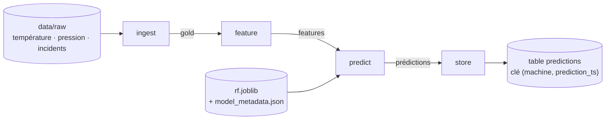

# Design du flow M29–M30 — InduSense

> Livrable M29 (pas-à-pas R2, « TP socle — flow « hello » + design »). Design **figé avant d'implémenter**
> (M30), à partir du code existant : `src/indusense/data/loaders.py`, `src/indusense/features/temporal.py`,
> `src/indusense/models/tabular.py` et la table `predictions` de `scripts/demo_prefect_idempotence.py`.
> Rédigé le 12/10/2026 (branche `ismael-sall`).

## Diagramme

## Contrats des tasks

| Task | Entree | Sortie | Effet de bord | Retry | Cle d'idempotence |
|---|---|---|---|---|---|
| **ingest** | `data_dir` : 3 sources brutes (température, pression, incidents) | **gold** : une ligne par (machine, timestamp), température + pression jointes par `merge_asof(by="machine", tolerance=90 min, direction="nearest")` | Aucun (lecture seule) | **Non** : fichier absent ou mal formé = erreur **déterministe** | — |
| **feature** | gold | gold + lags et moyennes glissantes, **par machine**, avec `shift(1)` **avant** `rolling` (pas de fuite temporelle, M23) | Aucun : transformation **pure** | **Non** : calcul pur, réessayer donne le même résultat | — |
| **predict** | features + chemin du modèle (`rf.joblib`) | `machine`, `prediction_ts`, `proba_panne`, `decision` (`alerte` si `proba_panne ≥ seuil`, sinon `ok`) | Aucun (lecture du modèle) | **Non** : modèle absent = erreur déterministe | — |
| **store** | prédictions + adresse de la base | Nombre de lignes écrites | **Écriture en base** (table `predictions`) | **Oui** : 3 réessais avec délai croissant (*backoff* 5 s, 15 s, 45 s) — la base est une **ressource externe**, ses pannes sont **transitoires** | **`(machine, prediction_ts)`** + **upsert** (`INSERT … ON CONFLICT (machine, prediction_ts) DO UPDATE`) |

## Erreurs par task

| Task | Erreur possible | Type | Réaction |
|---|---|---|---|
| ingest | Fichier absent · ID machine sans numéro (`normalize_machine_id`) · colonne manquante | Déterministe | Échec immédiat, message explicite |
| feature | Colonne manquante (`ValueError` de `add_temporal_features`) | Déterministe | Échec immédiat |
| predict | Modèle introuvable · features incomplètes | Déterministe | Échec immédiat |
| store | Base momentanément injoignable | **Transitoire** | **Retries + backoff** |

## Choix de conception

- **Une seule task a des retries : `store`**, la seule qui touche une ressource externe. On ne réessaie **que** le transitoire : réessayer un calcul pur ou une erreur de format ne change rien.
- **L'idempotence repose sur une clé**, pas sur « n'exécuter qu'une fois » : rejouer la même `(machine, prediction_ts)` **remplace** la ligne au lieu d'en créer une seconde ; `count(*)` reste stable.
- **Les pièges connus sont écrits dans le contrat** pour ne pas les oublier au M30 : `shift(1)` avant `rolling` (fuite temporelle, M23) et `by="machine"` (fuite inter-machines, M29 — sans lui, 75 % des lignes du jeu du dépôt recevraient la pression d'une autre machine, sans erreur).

## Points ouverts

- **Délais de retry** : 5 s / 15 s / 45 s sont ceux des contrats de la fiche TD 29 ; la démo `demo_prefect_idempotence.py` utilise 2 réessais après 1 s (pour la démonstration).
- **Seuil de décision** : 0,5 (celui de l'API, `config.py`) ; le seuil calculé au M24 est 0,975 → à trancher avec le formateur.
- **Base cible** : ~~à choisir au M30~~ → **tranché** : développement sur **SQLite** neuve (`$env:TEMP`), preuve finale sur **PostgreSQL dans Compose** (mode principal du pas-à-pas).
- **Délai de connexion** (constaté au M30) : sans `connect_timeout`, une base qui ne répond pas bloque chaque tentative de `store` ≈ 130 s sur ce poste. Le test l'a fixé à 3 s **dans l'URL de test seulement** ; en production, prévoir un délai maximal de connexion.
- **Jeu de données** : la preuve officielle (15 lignes, `panne` ≈ 4,7802 %) exige le jeu complet, absent du dépôt ; l'échantillon `data/raw` donne 4 lignes.

## Implémentation (M30)

> Code : [`src/indusense/flows/predict_flow.py`](../src/indusense/flows/predict_flow.py) — écrit le 13/10/2026, conforme au design ci-dessus.
> Lancer : `$env:INDUSENSE_DB_URL = "<url>"` puis `uv run python -m indusense.flows.predict_flow` (profil Prefect `ephemeral`).

| Élément du design | Réalisation |
|---|---|
| 4 tasks | `ingest` (loaders + `build_dataset`, `by="machine"`) · `feature` (`add_temporal_features` + `dropna`) · `predict` (dernière ligne par machine, seuil `settings.decision_threshold`) · `store` (upsert) — **aucune logique métier réécrite** |
| Populations nommées | `ingest` journalise `joined_rows / joined_panne_count / joined_panne_rate` ; `feature` journalise `gold_*` ; aucune ligne source publiée |
| Retries seulement sur `store` | `retries=3`, `retry_delay_seconds=[5, 15, 45]`, `retry_condition_fn=_is_transient` → réessaie **uniquement** `sqlalchemy.exc.OperationalError` |
| Clé + upsert | Table `predictions`, `PRIMARY KEY (machine, prediction_ts)` ; `INSERT … ON CONFLICT (machine, prediction_ts) DO UPDATE` — **même SQL** pour SQLite et PostgreSQL ; `created_at` (UTC) non écrasé à la relance |
| Base cible | Lue dans `INDUSENSE_DB_URL` (jamais journalisée ni passée en paramètre Prefect). `prediction_ts` adapté au pilote : ISO 8601 (SQLite) / `datetime` (PostgreSQL) |
| Pas de cache | `cache_policy=NO_CACHE` sur les 4 tasks : chaque run relit les sources et `store` s'exécute toujours |

**Preuves** : [30_tp_sqlite_idempotence.txt](../preuves/30_tp_sqlite_idempotence.txt) (2 runs → 4 → 4, 0 doublon) · [30_p2_retries.txt](../preuves/30_p2_retries.txt) (URL absente → échec immédiat ; base injoignable → 3 retries 5/15/45 s).

## Preuves attendues

- Deux executions sur la meme fenetre ne dupliquent aucune ligne.
- Un echec intermediaire peut etre repris sans recommencer aveuglement.
- Chaque run porte un nom et des parametres retrouvables.
